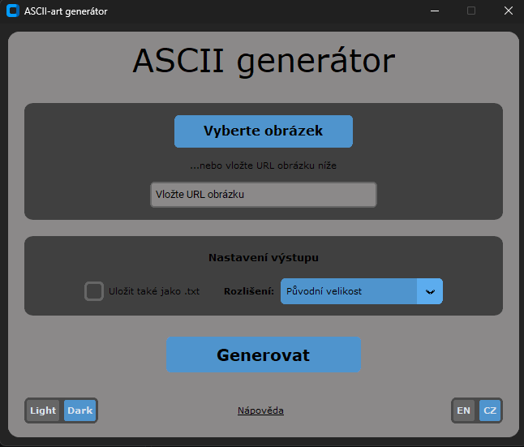
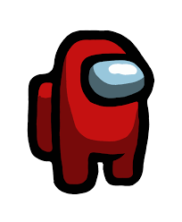
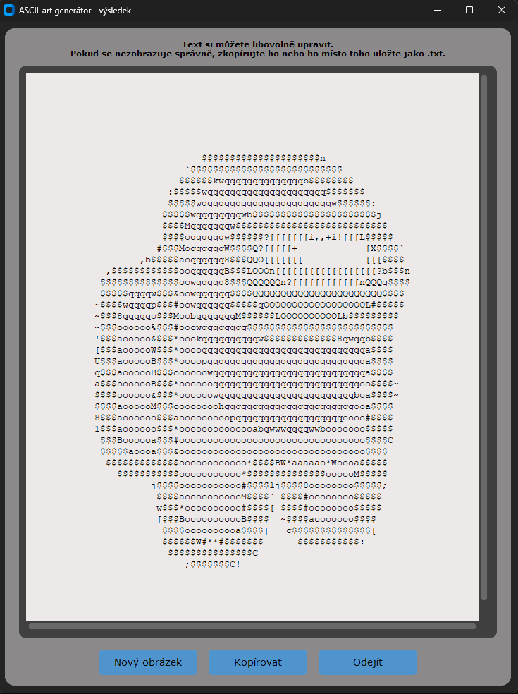

# ASCII art

[](https://github.com/MichalS16/ASCII-art/actions/workflows/ci.yml)

Zápočtový program

Program umožňující převést obrázek (`.png`/`.jpg`/`.jpeg`/`.webp`) do textové podoby, která je
složena z vybraných znaků anglické klávesnice a vypadá stejně jako původní obrázek.

## GUI

Na uživatelské rozhraní jsem použil knihovny `tkinter`, `customtkinter` a `requests`.

Po spuštění programu uživatel vloží URL svého obrázku nebo vloží svůj obrázek z PC.
Dále má možnost si vybrat, jestli chce vytvořený textový obrázek stáhnout do `.txt`,
a v poslední řadě vybrat rozlišení vytvořeného obrázku. Na výběr má 3 možnosti
rozlišení:

- zachovat původní velikost rozlišení obrázku,
- rozlišení vhodné pro SMS zprávy a mobilní zařízení,
- vlastní velikost rozlišení obrázku.

Po stisknutí "Generovat" se uživateli zobrazí nové okno s náhledem vygenerovaného
obrázku s možnostmi kopírovat text do schránky, začít znovu nebo odejít.

Uživatel si může přizpůsobit GUI výběrem barvy pozadí – "dark" a "light" – pro
příjemnou práci za jakéhokoliv osvětlení. V neposlední řadě si uživatel může zvolit
jazyk, ve kterém chce mít GUI. Kliknutím na "Nápověda" bude přesměrován na textový
soubor s podrobnou nápovědou.

GUI by mělo uživatele cíleně upozorňovat na chyby v jeho vstupech.

### Uživatelské rozhraní

<p align="center"></p>

| Vstupní obrázek | Výstup v ASCII art |
| :---: | :---: |
|  |  |

## Instalace a spuštění

Projekt používá [uv](https://docs.astral.sh/uv/) pro správu závislostí.

```bash
uv sync
uv run ascii-art
```

### Testy

```bash
uv run pytest --cov=ascii_art --cov-report=term-missing --cov-branch --cov-fail-under=100
```

### Lint

```bash
uv run ruff check .
```

CI (GitHub Actions, `.github/workflows/ci.yml`) spouští lint i testy s pokrytím při každém push/PR na `main`.

## Struktura repozitáře

```text
src/ascii_art/   zdrojový kód balíčku (GUI, generátor, pomocná logika, překlady)
tests/           unit testy
assets/          testovací obrázky
```

## ASCII art generátor

Na generování obrázku jsem použil knihovnu `Pillow`.

Metoda, na které generátor pracuje, je převedení každého pixelu obrázku do šedého
odstínu (grayscale) a vytvoření matice (listu) s hodnotami pro každý pixel. Následně
se z listu vybraných znaků anglické klávesnice, seřazených podle "hustoty pro jejich
pole", přiřadí každému znaku rozmezí šedého odstínu, které bude zastupovat. Tímto
způsobem vznikne list znaků, který se na závěr odřádkuje a spojí dohromady do
textového výstupu, jenž vypadá podobně jako původní obrázek.

## Použité knihovny

- [customtkinter](https://pypi.org/project/customtkinter)
- [Pillow](https://pypi.org/project/Pillow)
- [Requests](https://pypi.org/project/requests)
